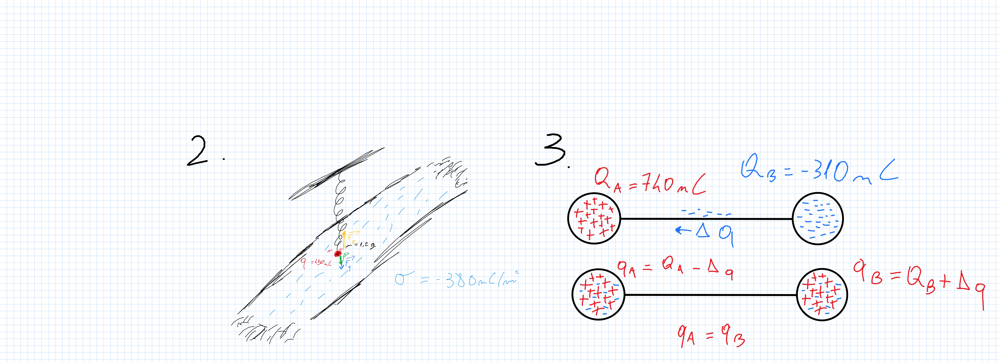

$\Huge{\mathbf{Grafici.}}$

I disegni del $\mathbf{4.}$ e del $\mathbf{5.}$ sono cortesia del libro.

$\Huge{\mathbf{Esercizio\ 2.}}$

Viene chiesto di calcolare l'allungamento nella posizione d'equilibrio, cioè nella configurazione in cui:

$$
\vec{P}+\vec{F_{q}}+\vec{F_{e}}=0\qquad (1)
$$

Essendo $\vec{P}, \vec{F_{q}}, \vec{F_{e}}$ la forza peso sulla particella, la forza elettrica e la forza elastica rispettivamente.

Dalla $(1)$ ricaviamo che:

$$
||\vec{F_{e}}||=||\vec{P}+\vec{F_{q}}||= ||\vec{P}||+||\vec{F_{q}}||
$$

Perché $\vec{P}, \vec{F_{q}}$ agiscono nella stessa direzione e nello steso verso (vedere il diagramma del corpo libero).

$$
kx=mg+ q|E|
$$

Si ricorda che nel caso di un piano uniformemente carico:

$$
E= \frac{\sigma}{2\varepsilon_{0}}
$$

Allora:

$$
x=\frac{mg}{k}+ \frac{q\sigma}{2k\varepsilon_{0}}= \frac{1.2 \times 10^{-3} \text{ kg } \cdot 9.8 \text{ N$/$kg}}{1.1 \text{ N$/$m}}+ \frac{450 \cdot 380 \times 10^{-18} \text{ C}^{2}}{2 \cdot 1.1 \text{N$/$m} \cdot 8.854 \times 10^{-12} \text{C}^{2}/\text{N$\cdot$m}^{2}} \approx 0.19 \text{ m}
$$

Quindi:

$$
x \approx 1.9 \text{cm}
$$

$\Huge{\mathbf{Esercizio\ 3.}}$

Gli elettroni in eccesso nella sfera $B$ passeranno spontaneamente sulla superficie della seconda sfera, poiché gli elettroni vanno dal punto di potenziale minore al punto di potenziale maggiore, e ovviamente:

$$
V_{1} >0 \text{ dato che } Q_{A} > 0, V_{2}< 0 \text{ dato che } Q_{B}<0 
$$

Quindi:

$$
V_{1}> V_{2}
$$

La sfera $A$ *guadagna* gli elettroni perduti dalla sfera $B$ fino a quando $V_{1}=V_{2}$. Detta $q_{A}$ la carica finale di $A$ e $q_{B}$ la carica finale di $B$ avremo che:

$$
q_{A}=q_{B}\qquad (1)
$$
Se chiamiamo $\Delta q$ la carica degli elettroni persi da $B$:

$$
q_{A}= Q_{A}- \Delta q;\qquad q_{B}=Q_{B}+\Delta q
$$

Dalla $(1)$:

$$
Q_{A}- \Delta q = Q_{B}+ \Delta q
$$

$$
\Delta q = \frac{Q_{A}-Q_{B}}{2}
$$

Dato che $q_{A}=q_{B}$, possiamo dire:

$$
q_{A}=q_{B}=q
$$

Allora il potenziale di ciascuna sfera è:

$$
V_{1,2}= k \frac{q}{r_{1,2}}
$$

Dato che $r_{1}=r_{2}=R$ abbiamo:

$$
V_{1}=V_{2}=V
$$

Calcoliamo $q$:

$$
q=Q_{A}-\Delta q = Q_{A}- \frac{Q_{A}-Q_{B}}{2}= \left( 740- \frac{740+310}{2} \right) \times 10^{-9} \text{ C} = 525 \times 10^{-9} \text{ C}
$$

$$
V= k \frac{q}{R}= 8.99 \times 10^{9} \text{ N$\cdot$m}^{2}/\text{C}^{2} \cdot \frac{525 \times 10^{-9} \text{ C}}{0.12 \text{ m}} \approx 16 \times 10^{3} \text{ V}
$$

Quindi:

$$
V=16 \text{kV}
$$

$\Huge{\mathbf{Esercizio\ 4.}}$

Dalla seconda legge di Ohm:

$$
R_{1}= \rho \frac{\ell_{1}}{S_{1}}\qquad (1) \\ \\ R_{2}= \rho \frac{\ell_{2}}{S_{2}}\qquad (2)
$$

Dove $R_{1},R_{2}$ sono le resistenze dei conduttori $1,2$ rispettivamente e $\ell_{1},\ell_{2}$ sono le lunghezze (il cui rapporto vogliamo calcolare) e $S_{1},S_{2}$ sono le superfici delle loro sezioni.

Si sa che $R_{1} \approx R_{2}$, quindi:

$$
\frac{R_{1}}{R_{2}} \approx 1
$$

Calcoliamo $S_{1},S_{2}$:

$$
S_{1}=\pi R^2-4\cdot \frac{1}{2}R^2= R^{2}(\pi-2) \\ \\ S_{2}= \pi R^{2}-\pi \left(   \frac{R}{2} \right)^{2}= \frac{3}{4} \pi R^2
$$

Dal rapporto di $(2) /  (1)$ otteniamo la $(3)$:

$$
\frac{\ell_{2}}{\ell_{1}}= \frac{S_{2}}{S_{1}}\qquad (3)
$$

Quindi:

$$
\frac{\ell_{2}}{\ell_{1}}= \frac{\frac{3}{4} \pi R^{2}}{R^{2}(\pi-2)}= \frac{3}{4} \cdot \frac{\pi}{\pi-2} \approx 2.1 
$$

$\Huge{\mathbf{Esercizio\ 5.}}$

Fare riferimento al diagramma del corpo libero.

Si riconosce che la configurazione è uguale a quella di un selettore di velocità, quindi:

$$
||\vec{v}||= \frac{||\vec{E}||}{||\vec{B}||}\qquad (1)
$$

Si calcola $|| \vec{E}||$:

$$
|| \vec{E}||= \frac{\Delta V}{||\Delta \vec{s}||}\qquad (2)
$$

Sostituendo il risultato della $(2)$:

$$
||\vec{v}|| = \frac{640 \text{ V}}{5 \times 10^{-3} \text{ m}} \cdot \frac{1}{1.2 \text{ T}} \approx 1.1 \times 10^{-4} \text{ m/s}
$$

